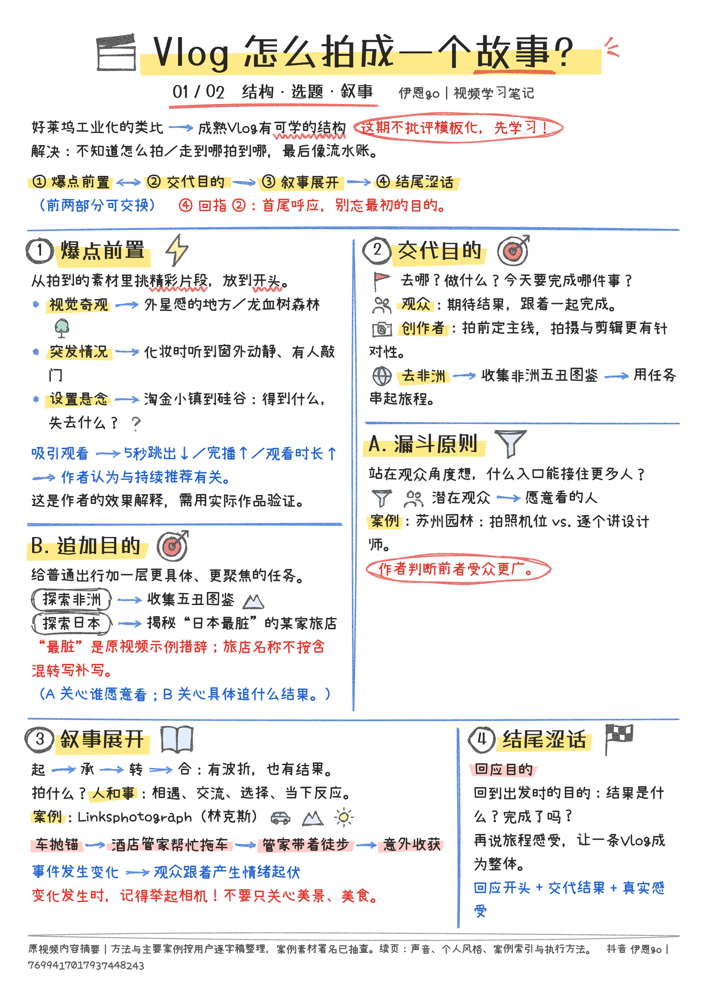

# 大纲转手写笔记 · handnote

把大纲写成文字，自动画成手绘风格的笔记图：马克笔标题、黄/红高光、圆圈章节号、蓝色箭头与分隔线、简笔小图标、流程方框。可以导出 PNG，也可以批量拆成小红书卡片。

**在线使用：<https://mona-ziranyun.github.io/handnote/>**（打开即用，不用安装）



## 功能

- **四种版式**：我的手账风（A4 一页拼版，默认）、课堂笔记、SOP 长图、思维导图
- **三栏工作台**：左边大纲可拖动排序；中间点纸面上的段落就能编辑；右边调样式
- **样式**：7 种纸张、7 套墨水配色（可自定义）、铅笔/马克笔/粉笔三种笔触、7 款开源手写字体
- **笔记语法**：`**高光**`、`==红色高光==`、`[[圆角框]]`、`A -> B` 箭头、`>> 流程方框`、`[相机]` 图标、表格等（界面顶部「笔记语法」可查看全部）
- **导出**：高清 PNG；批量生成小红书 3:4 卡片（带封面、页码），打包成 ZIP 下载；Markdown 导入/导出
- 撤销/重做，自动保存在浏览器本地

详细说明见 [使用说明.md](使用说明.md)。

## 本地运行

纯静态网页，不需要安装依赖。需要用本地服务打开（直接双击 `index.html` 加载不了字体）：

```bash
python3 -m http.server 5288
```

然后访问 <http://127.0.0.1:5288/>。macOS 上也可以直接双击 `启动手绘笔记.command`。

## 说明

- 笔记只保存在当前浏览器里（localStorage），不会上传到任何服务器。换浏览器或清除网站数据会丢失，重要笔记请导出 Markdown 备份。
- 字体均为开源字体（SIL Open Font License），已裁成常用字子集：小赖手写体、霞鹜漫黑、霞鹜文楷、马善政、龙藏、站酷快乐体、志莽行书。
- 第三方库：[Rough.js](https://github.com/rough-stuff/rough)（MIT）、[html-to-image](https://github.com/bubkoo/html-to-image)（MIT，修改了导出时的字号取整）、[JSZip](https://github.com/Stuk/jszip)（MIT）。
- 灵感参考：[sakuraoxo-clio/xiaohongshu-note](https://github.com/sakuraoxo-clio/xiaohongshu-note)。
